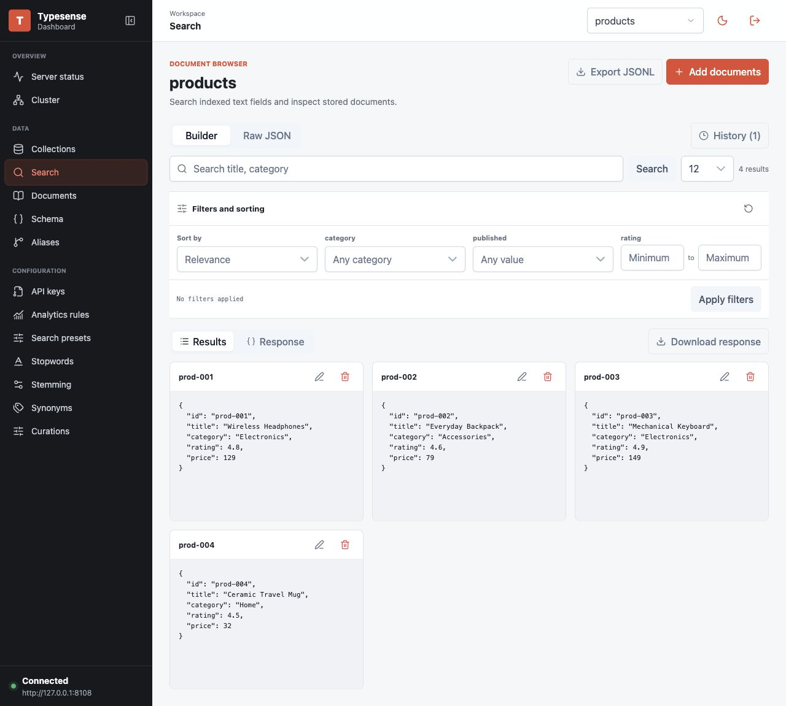
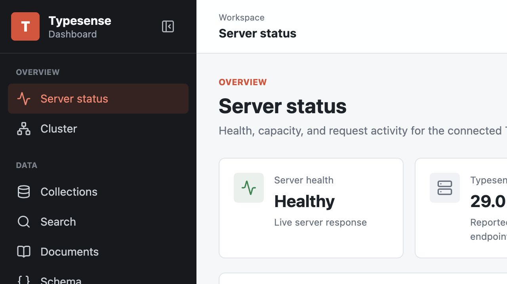
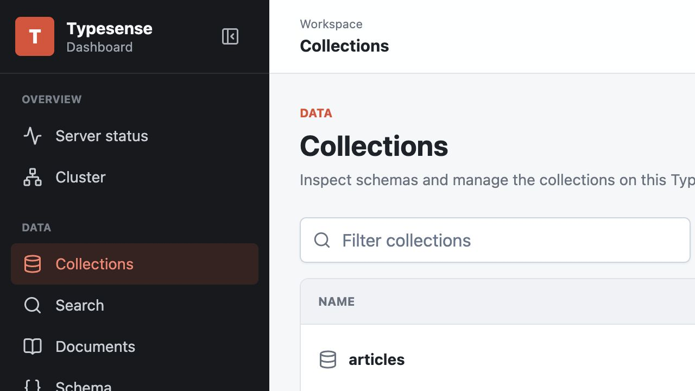

# Typesense Dashboard

A modern, open-source Typesense admin dashboard for managing collections, schemas, documents, search, and server health from your browser.

[](https://github.com/s1mpLyy/typesense-management-dashboard/actions/workflows/deploy-pages.yml)
[](https://vuejs.org/)
[](https://www.typescriptlang.org/)

[Live dashboard](https://s1mplyy.github.io/typesense-management-dashboard/) · [Features](#features) · [Screenshots](#screenshots) · [Local development](#local-development)



## About

Typesense Dashboard is a community-built web interface for operating a Typesense server. Connect a self-hosted or cloud Typesense node, inspect its health, manage collection schemas, import documents, and test searches without working directly with the REST API.

The application is a static Vue single-page app. It connects directly from your browser to the Typesense endpoint you provide—there is no application backend between the dashboard and your server.

> [!NOTE]
> This project is under active development. Collection, schema, document, search, and server-status workflows are implemented. Configuration areas that are still being migrated remain visible as placeholders; see the [implementation checklist](./IMPLEMENTATION_CHECKLIST.md) for current progress.

## Features

- Connect to self-hosted and cloud Typesense nodes over HTTP or HTTPS
- Monitor server health, version, storage usage, request activity, and collection totals
- List, filter, create, inspect, update, and delete collections
- Edit collection schemas and manage fields incrementally
- Add, upsert, and update documents with JSON or JSONL imports
- Browse, search, edit, delete, and export indexed documents
- Build search requests with facets, numeric filters, sorting, pagination, and highlights
- Run raw JSON searches and inspect or download complete Typesense responses
- Switch between light and dark themes in a responsive dashboard interface
- Keep connection credentials scoped to the current browser tab

## Screenshots

### Server health and metrics



### Collection management



### Document search


## Local development

### Requirements

- Node.js 22.13 or newer
- pnpm 11.16
- A reachable Typesense server and an API key with the permissions needed for the operations you want to perform

### Run the dashboard

```sh
git clone https://github.com/s1mpLyy/typesense-management-dashboard.git
cd typesense-management-dashboard
pnpm install
pnpm dev
```

Open the local URL printed by Vite, enter your Typesense host, port, protocol, and API key, then select **Connect**.

### Quality checks

```sh
pnpm check
pnpm build
```

Useful commands:

| Command             | Description                                           |
| ------------------- | ----------------------------------------------------- |
| `pnpm dev`          | Start the Vite development server                     |
| `pnpm test`         | Run the Vitest test suite                             |
| `pnpm test:e2e`     | Run Playwright end-to-end tests                       |
| `pnpm type-check`   | Check Vue and TypeScript types                        |
| `pnpm lint`         | Run ESLint                                            |
| `pnpm format:check` | Check Prettier formatting                             |
| `pnpm check`        | Run types, linting, unit tests, and formatting checks |
| `pnpm build`        | Create a production build in `dist/`                  |

## Connecting to Typesense

The hosted dashboard runs over HTTPS, so the Typesense node must also use HTTPS. Your node must allow browser CORS requests from the dashboard origin:

```text
https://s1mplyy.github.io
```

Use a narrowly scoped API key whenever possible. Administrative actions such as creating collections, changing schemas, or deleting documents require the corresponding Typesense permissions.

Credentials are entered at runtime, stored only in session storage for refresh recovery, and cleared when you disconnect or close the browser tab. They are not bundled into the application or sent to a separate dashboard backend.

## Tech stack

- Vue 3, Vue Router, and strict TypeScript
- Vite
- PrimeVue and Lucide Vue
- Pinia and TanStack Vue Query
- Typesense JavaScript client
- Zod and VeeValidate
- Monaco Editor
- Vitest, Vue Test Utils, MSW, and Playwright

See [STACK.md](./STACK.md) for architecture, state ownership, and security decisions.

## Deployment

Pushes to `main` run the complete quality gate and deploy the production build to [GitHub Pages](https://s1mplyy.github.io/typesense-management-dashboard/). To host the dashboard elsewhere, build the static application with `pnpm build` and publish the contents of `dist/`.

If the site is hosted below a subpath, set `VITE_BASE_PATH` during the build:

```sh
VITE_BASE_PATH=/your-subpath/ pnpm build
```

## Project status and roadmap

The dashboard currently covers its core collection and document workflows. Planned work includes cluster operations, aliases, API key management, analytics rules, search presets, stopwords, stemming dictionaries, synonyms, curations, additional end-to-end coverage, and release hardening.

- [Implementation checklist](./IMPLEMENTATION_CHECKLIST.md)
- [Implementation plan](./IMPLEMENTATION_PLAN.md)
- [Feature-parity checklist](./docs/parity-checklist.md)

## Contributing

Issues and pull requests are welcome. Before opening a pull request:

1. Create a focused branch.
2. Add or update tests for behavior changes.
3. Run `pnpm check` and `pnpm build`.
4. Describe the Typesense version and permissions used for manual verification.

This is a community project and is not presented as an official Typesense product.
